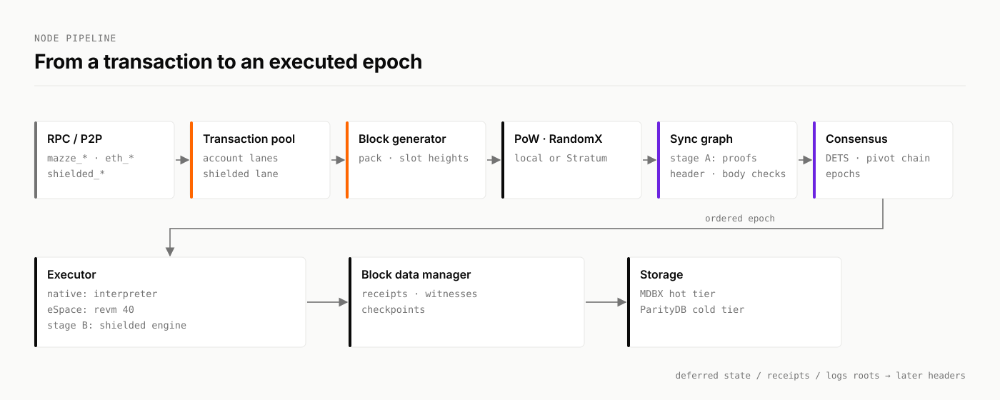

# Mazze node architecture

These pages describe the node in `mazze-rust-release`, one subsystem per page. Each page names the source files it describes.

<figure><picture><source srcset="../.gitbook/assets/brand/diagram-node-pipeline-dark.svg" media="(prefers-color-scheme: dark)"></picture><figcaption></figcaption></figure>

## Blocks and transactions

<table data-view="cards"><thead><tr><th></th><th></th><th data-hidden data-card-target data-type="content-ref"></th></tr></thead><tbody><tr><td><strong>Overview</strong></td><td>The pipeline end to end, and the crate map.</td><td><a href="overview.md">overview.md</a></td></tr><tr><td><strong>Block structure</strong></td><td>Header fields, the body and the shielded section.</td><td><a href="block-structure.md">block-structure.md</a></td></tr><tr><td><strong>Transaction pool</strong></td><td>Intake, validation, packing, and the shielded lane.</td><td><a href="transaction-pool.md">transaction-pool.md</a></td></tr><tr><td><strong>Block generation</strong></td><td>Assembling a block before mining.</td><td><a href="block-generation.md">block-generation.md</a></td></tr></tbody></table>

## Consensus

<table data-view="cards"><thead><tr><th></th><th></th><th data-hidden data-card-target data-type="content-ref"></th></tr></thead><tbody><tr><td><strong>PoW and mining</strong></td><td>RandomX, difficulty and Stratum.</td><td><a href="pow-and-mining.md">pow-and-mining.md</a></td></tr><tr><td><strong>DAG and DETS</strong></td><td>Parents, referees and the tree inside the DAG.</td><td><a href="dag-and-dets.md">dag-and-dets.md</a></td></tr><tr><td><strong>Consensus</strong></td><td>Pivot chain, epochs, timer chain and checkpoints.</td><td><a href="consensus.md">consensus.md</a></td></tr><tr><td><strong>Verification</strong></td><td>Header, block and transaction rules, and proof checks.</td><td><a href="verification.md">verification.md</a></td></tr></tbody></table>

## State and data

<table data-view="cards"><thead><tr><th></th><th></th><th data-hidden data-card-target data-type="content-ref"></th></tr></thead><tbody><tr><td><strong>Execution and state</strong></td><td>Epoch execution, the two VMs and the shielded engine.</td><td><a href="execution-and-state.md">execution-and-state.md</a></td></tr><tr><td><strong>Storage and snapshots</strong></td><td>MDBX and ParityDB, checkpoints and snapshots.</td><td><a href="storage-and-snapshots.md">storage-and-snapshots.md</a></td></tr><tr><td><strong>Genesis and params</strong></td><td>The genesis block and chain parameters.</td><td><a href="genesis-and-params.md">genesis-and-params.md</a></td></tr><tr><td><strong>Rewards and fees</strong></td><td>Base reward, fees, burning and penalties.</td><td><a href="rewards-and-fees.md">rewards-and-fees.md</a></td></tr></tbody></table>

## Network and interfaces

<table data-view="cards"><thead><tr><th></th><th></th><th data-hidden data-card-target data-type="content-ref"></th></tr></thead><tbody><tr><td><strong>Synchronization</strong></td><td>Catch-up phases and snapshot sync.</td><td><a href="synchronization.md">synchronization.md</a></td></tr><tr><td><strong>Networking</strong></td><td>P2P, discovery, peers and Dandelion++.</td><td><a href="networking.md">networking.md</a></td></tr><tr><td><strong>RPC and APIs</strong></td><td>JSON-RPC namespaces, transports and limits.</td><td><a href="rpc-and-apis.md">rpc-and-apis.md</a></td></tr><tr><td><strong>Node types</strong></td><td>Archive, full and light nodes.</td><td><a href="node-types-and-light-protocol.md">node-types-and-light-protocol.md</a></td></tr></tbody></table>
