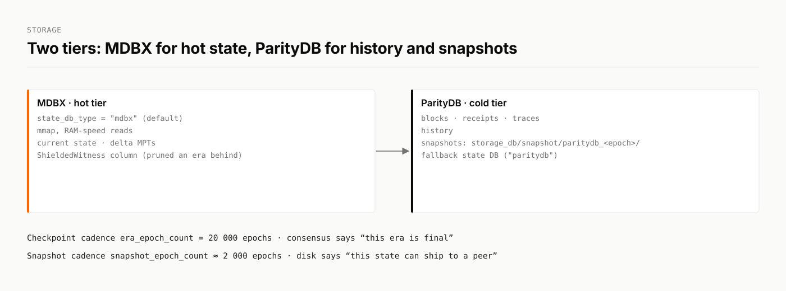

# Storage and snapshots

State persistence is provided by the `mazze-storage` crate. It combines a Merkle Patricia Trie (MPT) with snapshots and delta layers, on two database tiers.

<figure><picture><source srcset="../.gitbook/assets/brand/diagram-storage-dark.svg" media="(prefers-color-scheme: dark)"></picture><figcaption></figcaption></figure>

## Two tiers

| Tier | Engine | Holds |
| --- | --- | --- |
| **Hot** | MDBX (`libmdbx`), memory-mapped | Current state and delta MPTs. The `ShieldedWitness` column. |
| **Cold** | ParityDB | Blocks, receipts, traces, history, state snapshots |

* MDBX is the default state database: `state_db_type = "mdbx"`. Set `"paritydb"` to fall back to ParityDB.
* `MDBX_MAP_SIZE_MB` (default 65,536) sets the MDBX map size in the soak harness.
* The SQLite backend has been removed.

## Storage layers

* **Delta MPTs:** changes between snapshots.
* **Snapshot MPTs:** compact state at selected epochs.
* **One trie for three spaces.** Storage keys carry a space byte, so native, eSpace and shielded-space accounts share one state root. The shielded space uses the byte `0x82`, and decoders reject unknown space bytes.

## Checkpoints and snapshots

Two cadences, independent of each other:

| | Cadence | Meaning | Where |
| --- | --- | --- | --- |
| **Checkpoint** | `era_epoch_count`, default 20,000 epochs | Consensus says "this era is final" | Ledger DB, `COL_MISC` key `b"checkpoint"` |
| **Snapshot** | `snapshot_epoch_count`, about 2,000 epochs | The disk says "the state at this epoch is ready to ship to a peer" | `storage_db/snapshot/paritydb_<epoch_id>/` |

`snapshot_epoch_count` is clamped to the era length unless `test_allow_small_snapshot_epoch_count` is set.

### Safety rules

* **Cancellation.** A snapshot being built for a fork that stops being canonical is cancelled, and its temporary directory is removed.
* **Checks at registration.** A snapshot with a zero root, or with no parent in the delta chain, is refused.
* **No phantom snapshots.** A node advertises a snapshot only if its directory exists on disk.
* **Monotonic checkpoints.** The checkpoint epoch is persisted, and a checkpoint never moves backwards.
* **Startup check.** A node refuses to start if a retained snapshot's parent is missing. The error names the snapshot and the setting to look at, `keep_snapshot_before_stable_checkpoint`.

## Serving snapshots to new nodes

* Each manifest carries a Keccak hash per chunk. The receiver checks every chunk on arrival; a corrupt chunk is dropped and requested again from another peer.
* Chunk hashes are cached in three tiers (in memory, in an on-disk sidecar next to the snapshot, then computed). A peer that asks for manifests repeatedly cannot force repeated full-snapshot reads.

See [Synchronization](synchronization.md#snapshot-sync) for the receiving side.

## Interaction with consensus

`BlockDataManager` keeps a `StateAvailabilityBoundary` describing which epoch states can be read. Full nodes prune old state and still serve recent queries.

## Metrics

| Group | Counters |
| --- | --- |
| `snapshot.*` | `registered_total`, `pruned_total`, `cancelled_total`, `failed_total.*`, `in_flight`, `creation_duration_ms_total`, `invalid_root_at_registration_total`, `orphan_rejected_at_registration_total`, `advertised_but_missing_total` |
| `snapshot_sync.*` | `chunks_pending`, `chunks_downloading`, `chunks_completed_total`, `chunks_failed_total`, `chunk_hash_mismatch_total`, `manifest_chunk_hash_*` |
| `bdm.*` | `checkpoint_epoch_number` and cache sizes for headers, blocks, receipts and indexes |

## Key source files

- `crates/dbs/storage/src/lib.rs`
- `crates/dbs/storage/src/state_manager.rs`
- `crates/dbs/storage/src/impls/storage_db/kvdb_mdbx.rs`
- `crates/dbs/storage/src/impls/storage_manager/snapshot_manager.rs`
- `crates/dbs/storage/src/impls/merkle_patricia_trie/mod.rs`
- `crates/mazzecore/core/src/block_data_manager/mod.rs`
- `crates/mazzecore/core/src/sync/state/storage.rs`
