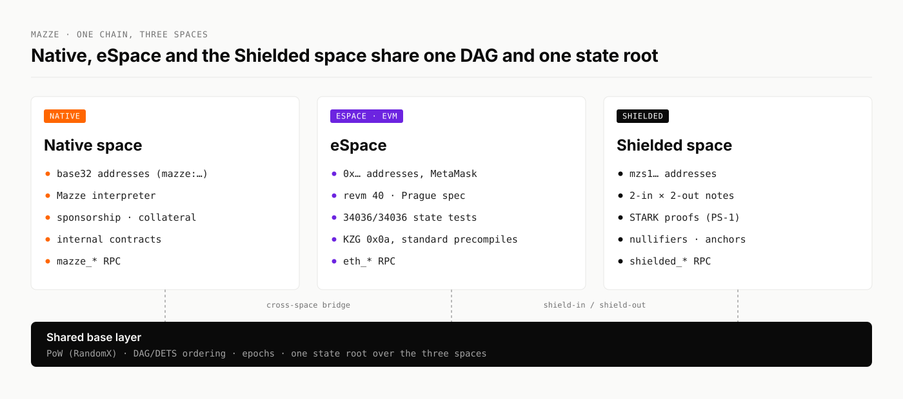

# Three spaces

A space is a separate account model with its own addresses, execution rules and RPC, inside one chain. All three spaces share the same blocks, the same PoW, the same epoch ordering and one state root. Value moves between them through built-in bridges.

<figure><picture><source srcset="../.gitbook/assets/brand/diagram-three-spaces-dark.svg" media="(prefers-color-scheme: dark)"></picture><figcaption></figcaption></figure>



<mark style="color:orange;">**● NATIVE**</mark>

The native space is where Mazze-specific features live.

* **Addresses** are base32 strings with a network prefix, for example `mazze:aak2…` on mainnet.
* **Execution** runs on Mazze's own interpreter.
* **Sponsorship** lets a contract pay its users' gas and storage collateral.
* **Storage collateral** charges for the state an account occupies.
* **Internal contracts** live at fixed addresses: AdminControl, SponsorWhitelistControl, the cross-space bridge, and the shield-in bridge.
* **RPC:** `mazze_*`, plus `debug_*`, `trace_*` and `txpool_*`.



<mark style="color:purple;">**● ESPACE · EVM**</mark>

eSpace is fully Ethereum-compatible, so Ethereum tools work without changes.

* **Addresses** are ordinary `0x…` addresses.
* **Execution** runs on **revm 40.0.0** with the **Prague** spec. It passes all 34,036 `GeneralStateTests` from `ethereum/tests`.
* **Wallets and tools:** MetaMask, ethers, viem, Foundry and Hardhat.
* **RPC:** `eth_*` and `net_version`, plus `eth_subscribe`, `debug_*` and `trace_*`. The `finalized` tag returns the latest checkpoint.

See [EVM compatibility](../developers/evm-compatibility.md).



**● SHIELDED**

The shielded space holds value as private notes.

* **Addresses** start with `mzs1`.
* **Transactions** spend two notes and create two, proven with a post-quantum STARK. They carry no sender, nonce, signature or gas.
* **Amounts and owners** stay hidden. Only shield-in and shield-out amounts are public.
* **RPC:** `shielded_*`.

The shielded space is running on devnet and is inactive on public networks until its activation height. See [Shielded space](../privacy/README.md).



## Moving value between spaces

| From → to | How |
| --- | --- |
| Native → eSpace | `transferEVM` on the cross-space bridge internal contract. `callEVM`, `createEVM` and `staticCallEVM` reach eSpace contracts the same way. |
| eSpace → Native | `withdrawFromMapped` on the cross-space bridge, from the mapped account |
| Native → Shielded | **Shield-in:** call `shieldIn(bodyHash)` on the shield-in bridge with the amount as the value. The shielded transaction with that body hash then consumes the deposit. |
| Shielded → Native or eSpace | **Shield-out:** a shielded transaction with `v_public_out > 0` pays its destination from the backing balance. |

Every native account has a **mapped address** in eSpace, derived deterministically from its native address. The cross-space bridge is dispatched before either VM runs, so neither the native interpreter nor revm sees cross-space calls.

## Shared base layer

* **Proof of Work** with RandomX. See [PoW and mining](../architecture/pow-and-mining.md).
* **DAG and DETS.** Blocks reference a parent and any number of referees. Consensus picks a pivot chain and orders every block into epochs. See [DAG and DETS](../architecture/dag-and-dets.md).
* **One state.** Storage keys carry a space byte, so the three spaces live in one state trie under one state root.
* **Per-space fees.** Each block header carries a base price per space. The shielded space uses one constant fee per transaction instead, burned in full.
