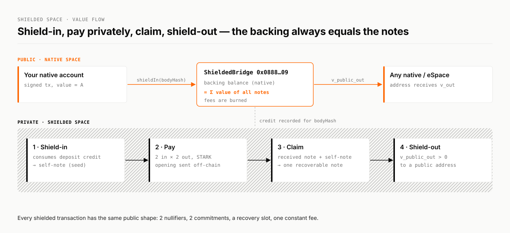

# Shielded space

The shielded space is Mazze's third space. It holds value as private **notes**. A shielded transaction spends notes and creates new ones, and a zero-knowledge proof shows the spend is valid without revealing the owners or the amounts.


**Status.** The shielded space is implemented on the `shielded-space` branch and runs end to end on a local devnet: shield-in, a private payment, shield-out, backing equal to the sum of the notes, burned fees, refused double-spends. On public networks the lane stays **inactive** until an activation height is set.


<figure><picture><source srcset="../.gitbook/assets/brand/diagram-shielded-flow-dark.svg" media="(prefers-color-scheme: dark)"></picture><figcaption></figcaption></figure>

## Why it is built this way

| Goal | How the shielded space gets there |
| --- | --- |
| **Privacy that lasts** | Note commitments are statistically hiding. What a note contains cannot be revealed later, by any amount of computing power, quantum computers included. |
| **No trusted setup** | Proofs are STARKs: transparent, hash-based, with no setup ceremony and no trapdoor that could mint coins. |
| **Post-quantum soundness** | Security rests on hash functions (Poseidon2, Keccak-256, SHAKE256), not on elliptic curves or pairings. |
| **Nothing to tell apart** | Every transaction spends two notes and creates two, carries a recovery slot and pays the same constant fee. Shield-in, payment and claim look alike. |
| **A node that knows nothing** | The node never sees a key, a note opening or a Merkle path. Wallets prove locally and rebuild the tree from public data. |
| **Recovery from a seed** | Change and claimed notes can be rebuilt from the 32-byte seed alone. |
| **Supply you can check** | All shielded value sits in one native balance, the backing. The backing always equals the sum of the notes. |

## Pages

<table data-view="cards"><thead><tr><th></th><th></th><th data-hidden data-card-target data-type="content-ref"></th></tr></thead><tbody><tr><td><strong>Design</strong></td><td>The threat model, what is public, and the two-stage pipeline.</td><td><a href="overview.md">overview.md</a></td></tr><tr><td><strong>Notes, keys and nullifiers</strong></td><td>The commitment, the spend keys, and how double spends are stopped.</td><td><a href="notes-and-keys.md">notes-and-keys.md</a></td></tr><tr><td><strong>Proof system PS-1</strong></td><td>The 2×2 spend statement and the STARK that proves it.</td><td><a href="proof-system.md">proof-system.md</a></td></tr><tr><td><strong>The shielded lane</strong></td><td>Block sections, slots, fees, verification and execution.</td><td><a href="shielded-lane.md">shielded-lane.md</a></td></tr><tr><td><strong>Wallet guide</strong></td><td>Shield in, pay, receive, claim, shield out and restore.</td><td><a href="wallet.md">wallet.md</a></td></tr><tr><td><strong>Shielded RPC</strong></td><td>The four <code>shielded_*</code> methods and what they return.</td><td><a href="rpc.md">rpc.md</a></td></tr></tbody></table>

## Legacy pool

Before the shielded space, Mazze shipped a Groth16 shielded pool as an internal contract in the native space. It is still in the code base. Its documentation is under [Legacy pool (Groth16)](legacy-pool.md).
