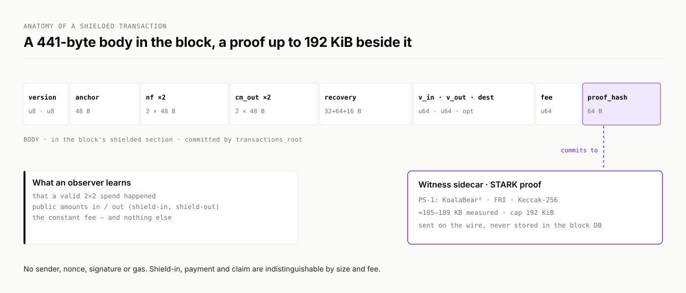

# Design

## Threat model

The shielded space is designed for an adversary who records everything public today and attacks it later, possibly with a quantum computer.

* **Privacy must survive.** Commitments are statistically hiding, so recorded data reveals nothing about a note's owner, value or randomness, whatever the attacker's computing power.
* **Soundness must not depend on a trapdoor.** There is no trusted setup. Forging a proof means breaking the hash functions.
* **A broken hash would allow counterfeiting going forward, not exposure of the past.** Binding is computational (a Poseidon2 collision would be needed). Hiding does not depend on Poseidon2 at all.

## What is public

<figure><picture><source srcset="../.gitbook/assets/brand/diagram-shielded-tx-dark.svg" media="(prefers-color-scheme: dark)"></picture><figcaption></figcaption></figure>

| Public | Hidden |
| --- | --- |
| That a valid 2-in × 2-out spend happened | Who sent it, and to whom |
| Two nullifiers and two output commitments | Which notes were spent |
| The anchor (a past tree root) | The amounts of the notes |
| The shield-in amount, for a shield-in | Links between the spends of one user |
| The shield-out amount and destination, for a shield-out | The note openings |
| The constant fee | |
| A recovery tag and a sealed recovery slot | Their meaning, without the sender's seed |

A shielded body has no sender, no nonce, no signature and no gas. The proof alone authorises the spend.

## Lifecycle of a shielded transaction



### Build and prove in the wallet

The wallet picks two input notes (or dummies), creates two outputs, fixes the body, and proves the 2×2 statement locally. The proof binds the body through a sighash, and the body commits to the proof through `proof_hash`.



### Admit to the pool

`shielded_sendRawTransaction(body, proof)` submits it. The node checks the fee, the proof, the anchor and the nullifiers, then puts it in the shielded lane of the transaction pool.



### Relay with Dandelion++

The transaction first travels a *stem*, one peer at a time, before it is broadcast. The node it came from is then not the first to broadcast it.



### Pack at a slot height

Only blocks at slot heights may carry a shielded section. The block generator packs shielded transactions there, in random order.



### Stage A: verify when the block is accepted

Every proof in the block is verified before the block enters the sync graph. A block with an invalid proof is invalid.



### Stage B: execute with the epoch

When a slot epoch executes, the shielded engine applies each transaction to the pool state: it marks nullifiers spent, appends the commitments, moves value in or out of the backing, and burns the fee.



### Sync in the wallet

The wallet reads the executed sections, rebuilds the commitment tree, finds its notes and their positions, and marks spent notes.



## Where the state lives

The pool state lives in two accounts at the shield-in bridge address `0x0888…09`:

* **in the shielded space:** spent nullifiers, the frontier of the commitment tree, the recorded roots (anchors), and deposit credits for shield-ins;
* **in the native space:** the **backing balance**, which holds every unit of value inside the shielded space. It pays shield-outs. Fees are burned from it.


**The turnstile.** Value enters only through shield-in and leaves only through shield-out and burned fees, so the backing always equals the sum of the notes. If a shield-out ever exceeded the backing, the transaction would be skipped (`Backing`). It is never expected to happen.


## Network separation

A proof is valid for one chain only. The Fiat–Shamir transcript starts from a domain that includes the chain ID, the proof system ID and the circuit ID, and the sighash covers the chain ID. The shielded chain ID is set with `shielded_chain_id` and defaults to the chain's ID.
